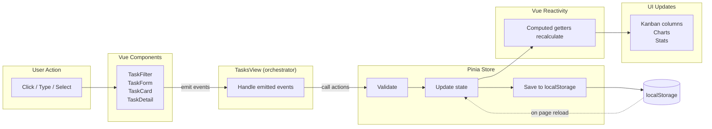

<div align="center">
  <h1>MiniTask</h1>

  <p>A responsive personal task manager where users can create tasks, organize them by status, track progress, and find work quickly through search and priority filtering.</p>

  <a href="https://mini-task.pages.dev" target="_blank">
    
  </a>
</div>

## Table of Contents

- [Table of Contents](#table-of-contents)
- [Features](#features)
- [Tech Stack](#tech-stack)
- [Project Structure](#project-structure)
- [Getting Started](#getting-started)
    - [Prerequisites](#prerequisites)
    - [Installation](#installation)
- [Available Scripts](#available-scripts)
- [Application Architecture](#application-architecture)
    - [Routing](#routing)
    - [Layouts](#layouts)
    - [State Management](#state-management)
    - [Data Flow](#data-flow)
- [Component Reference](#component-reference)
    - [Task Components](#task-components)
    - [UI Components](#ui-components)
- [Data Model](#data-model)
- [Persistence](#persistence)
- [Styling and Design Tokens](#styling-and-design-tokens)
    - [Color Tokens](#color-tokens)
    - [Shadow Tokens](#shadow-tokens)
    - [Custom Utility Classes](#custom-utility-classes)
    - [Base Layer Resets](#base-layer-resets)
- [Responsive Design](#responsive-design)
- [Seed Data](#seed-data)
- [Author](#author)

## Features

- **Task CRUD** -- Create, read, update, and delete tasks with title, description, and priority.
- **Kanban Board** -- Three-column layout: To Do, In Progress, Done.
- **Status Management** -- Change task status via inline dropdown or detail modal.
- **localStorage Persistence** -- Tasks survive page refreshes without a backend.
- **Search** -- Real-time case-insensitive title search with clear button.
- **Priority Filtering** -- Filter tasks by Low, Medium, or High priority.
- **Task Detail View** -- Full-screen modal showing complete task information.
- **Progress Tracking** -- Completion percentage, task counts, and visual charts.
- **Analytics Dashboard** -- Overview page with radial bar, horizontal bar, and donut charts.
- **Confirmation Dialogs** -- Destructive actions require explicit confirmation.
- **Responsive Design** -- Mobile-first layouts that adapt from phones to desktops.

## Tech Stack

| Category         | Technology                                                                  |
| ---------------- | --------------------------------------------------------------------------- |
| Framework        | [Vue.js 3](https://vuejs.org/)                                              |
| Routing          | [Vue Router 5](https://router.vuejs.org/)                                   |
| State Management | [Pinia 4](https://pinia.vuejs.org/)                                         |
| Styling          | [Tailwind CSS 4](https://tailwindcss.com/)                                  |
| Build Tool       | [Vite 8](https://vitejs.dev/)                                               |
| Icons            | [Lucide](https://lucide.dev/)                                               |
| Charts           | [ApexCharts](https://apexcharts.com/)                                       |
| Linting          | [ESLint 10](https://eslint.org/) + [OxLint](https://oxc-project.github.io/) |
| Formatting       | [Prettier 3](https://prettier.io/)                                          |
| Package Manager  | [pnpm](https://pnpm.io/)                                                    |

## Project Structure

```
MiniTask/
├── index.html                          # SPA entry point
├── package.json                        # Dependencies and scripts
├── pnpm-lock.yaml                      # Lockfile
├── vite.config.js                      # Vite build configuration
├── eslint.config.js                    # ESLint flat config
├── .oxlintrc.json                      # OxLint configuration
├── .prettierrc.json                    # Prettier configuration
├── .editorconfig                       # Editor conventions
├── jsconfig.json                       # IDE path aliases
├── public/
│   └── favicon.ico                     # App favicon
└── src/
    ├── main.js                         # App bootstrap and plugin registration
    ├── App.vue                         # Root component
    ├── assets/
    │   └── styles/
    │       └── main.css                # Tailwind v4 imports and design tokens
    ├── components/
    │   ├── tasks/
    │   │   ├── TaskCard.vue            # Individual task card with priority accent
    │   │   ├── TaskDetail.vue          # Full task detail modal
    │   │   ├── TaskFilter.vue          # Search and priority filter bar
    │   │   ├── TaskForm.vue            # Create/edit task modal form
    │   │   ├── TaskList.vue            # Kanban column wrapper
    │   │   └── EmptyState.vue          # Empty column placeholder
    │   └── ui/
    │       └── ConfirmDialog.vue       # Destructive action confirmation modal
    ├── data/
    │   └── seed.js                     # Mock seed tasks for first load
    ├── layouts/
    │   └── DashboardLayout.vue         # Sidebar + topbar + content shell
    ├── router/
    │   └── index.js                    # Vue Router route definitions
    ├── stores/
    │   └── taskStore.js                # Pinia store for all task state
    ├── utils/
    │   ├── storage.js                  # localStorage read/write helpers
    │   └── validation.js               # Input validation and normalization
    └── views/
        ├── marketing/
        │   └── HomeView.vue            # Landing page
        └── dashboard/
            ├── OverviewView.vue        # Analytics dashboard with charts
            └── TasksView.vue           # Kanban task board
```

## Getting Started

### Prerequisites

- [Node.js](https://nodejs.org/) `^22.18.0` or `>=24.12.0`
- [pnpm](https://pnpm.io/) package manager

### Installation

```bash
# Clone the repository
git clone https://github.com/atia-farha/MiniTask.git

# Navigate to the project directory
cd MiniTask

# Install dependencies
pnpm install

# Start the development server
pnpm dev
```

Open [http://localhost:5173](http://localhost:5173) in your browser.

## Available Scripts

| Script         | Command              | Description                                                   |
| -------------- | -------------------- | ------------------------------------------------------------- |
| `pnpm dev`     | `vite`               | Start the Vite development server with hot module replacement |
| `pnpm build`   | `vite build`         | Compile and minify for production (output: `dist/`)           |
| `pnpm preview` | `vite preview`       | Serve the production build locally for testing                |
| `pnpm lint`    | `run-s "lint:*"`     | Run OxLint then ESLint with auto-fix (writes files)           |
| `pnpm format`  | `prettier --write .` | Format all files with Prettier (writes files)                 |

> **Note:** `pnpm lint` and `pnpm format` are write commands that modify files in place. For a read-only lint check, run `pnpm exec eslint .` directly. For format verification, run `pnpm exec prettier --check src/`.

## Application Architecture

### Routing

Three routes are defined:

| Path               | Name       | Component      | Description                                    |
| ------------------ | ---------- | -------------- | ---------------------------------------------- |
| `/`                | `home`     | `HomeView`     | Marketing landing page (standalone, no layout) |
| `/dashboard`       | `overview` | `OverviewView` | Analytics dashboard (inside `DashboardLayout`) |
| `/dashboard/tasks` | `tasks`    | `TasksView`    | Kanban task board (inside `DashboardLayout`)   |

**Navigation behavior:**

- The marketing page (`/`) links to the dashboard via "Open workspace" and "Start for free" buttons.
- The dashboard layout contains a sidebar with links to Overview and Tasks.
- The "New Task" button in the topbar opens the task form and navigates to `/dashboard/tasks` if the user is on the Overview page.
- An `afterEach` hook sets `document.title` to `"<page title> | MiniTask"` on every navigation.

### Layouts

**DashboardLayout** is a full-screen flex container with three sections:

1. **Sidebar** (`<aside>`) -- Fixed off-canvas on mobile, static on `lg:` breakpoint. Collapsible to 60px on desktop. Contains the app logo, navigation links, and collapse toggle. Sidebar collapse state is persisted to `localStorage` under the key `minitask.sidebar.collapsed`.

2. **Topbar** (`<header>`) -- Fixed height bar with a hamburger menu (mobile), page title, and "New Task" button.

3. **Main Content** (`<main>`) -- Scrollable area that renders child routes via `<RouterView />`.

### State Management

All task state lives in a single Pinia store (`src/stores/taskStore.js`).

**State (refs):**

| Ref                | Type      | Purpose                                                          |
| ------------------ | --------- | ---------------------------------------------------------------- |
| `tasks`            | `Array`   | Master task collection (loaded from localStorage or seed data)   |
| `searchQuery`      | `String`  | Current search filter text                                       |
| `selectedPriority` | `String`  | Current priority filter (`'all'`, `'low'`, `'medium'`, `'high'`) |
| `showForm`         | `Boolean` | Controls task form modal visibility                              |

**Computed Getters:**

| Getter                                 | Description                                                    |
| -------------------------------------- | -------------------------------------------------------------- |
| `total`                                | Total number of tasks (unfiltered)                             |
| `doneCount`                            | Count of tasks with status `done`                              |
| `progress`                             | Completion percentage: `Math.round((doneCount / total) * 100)` |
| `filteredTasks`                        | Tasks matching both search query and priority filter           |
| `todoTasks`                            | Filtered tasks with status `todo`                              |
| `inProgressTasks`                      | Filtered tasks with status `in-progress`                       |
| `doneTasks`                            | Filtered tasks with status `done`                              |
| `counts`                               | Aggregate counts per status and priority                       |
| `todoCount`, `inProgressCount`         | Individual status counts                                       |
| `highCount`, `mediumCount`, `lowCount` | Individual priority counts                                     |

**Actions:**

| Action                                      | Description                                                        |
| ------------------------------------------- | ------------------------------------------------------------------ |
| `addTask({ title, description, priority })` | Validates input, generates a UUID, creates and persists a new task |
| `updateTask(id, updates)`                   | Validates updated fields, merges changes, and persists             |
| `removeTask(id)`                            | Removes a task by ID and persists                                  |
| `changeStatus(id, status)`                  | Convenience wrapper around `updateTask` for status changes         |
| `setSearch(query)`                          | Updates the search filter                                          |
| `setPriority(priority)`                     | Updates the priority filter                                        |

Every mutation calls `persist()`, which writes the full task array to localStorage.

### Data Flow



**How the flow works:**

1. **Store Initialization** -- On first load, `loadTasks()` reads `minitask.tasks` from localStorage. If the data is missing, empty, or malformed (no valid `id`/`title` on items), it falls back to `seedTasks`. The result is stored in a reactive `ref`.
2. **User Interaction** -- Every user action originates in a child component (TaskFilter, TaskForm, TaskCard, TaskDetail). These components never call the store directly. Instead, they emit named events upward.
3. **TasksView Orchestration** -- TasksView receives all emitted events and calls the corresponding store action (`addTask`, `updateTask`, `removeTask`, `changeStatus`, `setSearch`, `setPriority`). It also manages local state for the editing task reference and form visibility.
4. **Store Internal Pipeline** -- Each mutation follows the same path: validate input via `validateTitle`/`validateDescription`, normalize fields via `normalizeTask`, mutate the reactive `tasks` array, then call `persist()` which writes the full array to localStorage.
5. **Reactive Recalculation** -- After state mutation, all computed getters (`filteredTasks`, `todoTasks`, `inProgressTasks`, `doneTasks`, `total`, `doneCount`, `progress`, `counts`, and individual count getters) automatically recalculate. Vue's reactivity system propagates these changes to every component that reads them.
6. **UI Re-render** -- TaskList columns re-render with the latest filtered tasks. OverviewView's charts and stats cards update with the latest counts and progress percentage. The entire chain from user action to visual update is synchronous within Vue's reactivity tick.

## Component Reference

### Task Components

**TaskFilter** (`src/components/tasks/TaskFilter.vue`)

- Search input with magnifying glass icon and clear button
- Priority dropdown (All, High, Medium, Low)
- Emits: `update:search`, `update:priority`

**TaskList** (`src/components/tasks/TaskList.vue`)

- Renders a single Kanban column with header, task count badge, and card list
- Props: `tasks`, `title`, `accentColor`, `emptyMessage`, `emptySub`
- Shows `EmptyState` when the task list is empty

**TaskCard** (`src/components/tasks/TaskCard.vue`)

- Individual task card with priority-colored left accent bar
- Title (clickable to open detail modal), description (2-line clamp)
- Priority badge with colored dot
- Inline status `<select>` for quick status changes
- Dimmed appearance (`opacity-60`) and strikethrough title for completed tasks

**TaskDetail** (`src/components/tasks/TaskDetail.vue`)

- Full-screen modal (Teleported to `<body>`) showing complete task information
- Displays title, priority badge, full description, and status dropdown
- Footer with Edit and Delete buttons
- Closes on Escape key or backdrop click
- Delete triggers the `ConfirmDialog`

**TaskForm** (`src/components/tasks/TaskForm.vue`)

- Modal form for creating or editing tasks
- Title input with 120-character counter and autofocus
- Description textarea with 1000-character counter
- Priority selector: three-button toggle group (Low / Medium / High)
- Inline validation error display
- Watches `editTask` prop to populate fields in edit mode
- Closes on Escape or backdrop click

**EmptyState** (`src/components/tasks/EmptyState.vue`)

- Centered placeholder with Inbox icon
- Configurable `message` and `submessage` props

### UI Components

**ConfirmDialog** (`src/components/ui/ConfirmDialog.vue`)

- Destructive action confirmation modal (Teleported to `<body>`)
- Warning icon, message, and "This action cannot be undone." subtext
- Cancel and Confirm buttons (danger-styled)
- Closes on Escape or backdrop click

## Data Model

Every task follows this shape:

```js
{
  id: String,          // crypto.randomUUID() -- client-generated, collision-free
  title: String,       // Required. Trimmed. Max 120 characters.
  description: String, // Optional. Trimmed. Max 1000 characters.
  priority: String,    // 'low' | 'medium' | 'high' (default: 'low')
  status: String,      // 'todo' | 'in-progress' | 'done' (default: 'todo')
}
```

**Validation rules:**

- Title cannot be empty or whitespace-only.
- Title cannot exceed 120 characters.
- Description cannot exceed 1000 characters.
- Empty description is allowed.
- All input is trimmed before storage.

## Persistence

| Key                          | Content                        | Managed By                                 |
| ---------------------------- | ------------------------------ | ------------------------------------------ |
| `minitask.tasks`             | JSON array of task objects     | `src/utils/storage.js` via the Pinia store |
| `minitask.sidebar.collapsed` | Boolean sidebar collapse state | `DashboardLayout.vue` directly             |

**Loading behavior:**

1. On app startup, `loadTasks()` reads `minitask.tasks` from localStorage.
2. If the key is missing, empty, or contains invalid JSON, it falls back to the seed data from `src/data/seed.js`.
3. Each item is validated to have a non-empty `id` and trimmed `title`. Invalid items are silently filtered out.

**Saving behavior:**

- `saveTasks()` is called after every store mutation (add, update, remove).
- Errors (quota exceeded, security sandbox) are caught and surfaced via `alert()`.

## Styling and Design Tokens

The project uses Tailwind CSS 4 with the `@theme` directive in `src/assets/styles/main.css`.

### Color Tokens

| Token                   | Value     | Usage                   |
| ----------------------- | --------- | ----------------------- |
| `--color-primary`       | `#e24790` | Primary brand pink      |
| `--color-primary-light` | `#eaa8c8` | Light pink for accents  |
| `--color-background`    | `#f9e8f1` | Page background         |
| `--color-surface`       | `#fffafd` | Card and modal surfaces |
| `--color-ink`           | `#2b1b27` | Primary text color      |
| `--color-muted`         | `#735f6d` | Secondary/muted text    |
| `--color-accent`        | `#5f3c8d` | Purple accent           |
| `--color-success`       | `#1f8a70` | Success/green           |
| `--color-danger`        | `#dc3545` | Error/red               |
| `--color-warning`       | `#f59e0b` | Warning/amber           |
| `--color-info`          | `#3b82f6` | Info/blue               |
| `--color-hover`         | `#e86ba6` | Hover state pink        |
| `--color-board-bg`      | `#f4eff3` | Board background        |
| `--color-card-bg`       | `#ffffff` | Card background         |
| `--color-column-bg`     | `#f9f5f8` | Column background       |
| `--color-border`        | `#e8dde5` | Default border          |
| `--color-border-light`  | `#f0e8ed` | Light border            |

### Shadow Tokens

| Token                 | Usage                  |
| --------------------- | ---------------------- |
| `--shadow-card`       | Default card elevation |
| `--shadow-card-hover` | Card hover state       |
| `--shadow-modal`      | Modal dialog elevation |
| `--shadow-soft`       | Subtle soft shadow     |

### Custom Utility Classes

| Class                           | Description                                               |
| ------------------------------- | --------------------------------------------------------- |
| `.btn`                          | Base button: flex, inline, gap, font-semibold, focus ring |
| `.btn-primary`                  | Pink background, white text                               |
| `.btn-secondary`                | White background, bordered                                |
| `.btn-danger`                   | Red background, white text                                |
| `.btn-sm`, `.btn-md`, `.btn-lg` | Button size variants                                      |
| `.btn-rounded-xl`               | Extra-large border radius                                 |
| `.container`                    | Max-width 500rem, centered                                |

### Base Layer Resets

- `box-sizing: border-box` on all elements
- Custom thin scrollbar styling (pink-themed)
- Text selection highlight: pink background with light text
- Smooth scrolling on `html`
- Inter font family on `body` with antialiased rendering
- Transitions on interactive elements (`button`, `a`, `input`, `textarea`)

## Responsive Design

The application follows a mobile-first approach using Tailwind CSS responsive prefixes.

| Breakpoint       | Behavior                                                                           |
| ---------------- | ---------------------------------------------------------------------------------- |
| Default (mobile) | Single-column Kanban, stacked filter bar, off-canvas sidebar with backdrop overlay |
| `sm:`            | Horizontal filter bar layout                                                       |
| `md:`            | Three-column Kanban grid (`md:grid-cols-3`)                                        |
| `lg:`            | Static sidebar, 4-column stats grid, 3-column chart grid, full desktop layout      |

**Key responsive patterns:**

- Sidebar uses `translate-x` for mobile slide-in/out with backdrop overlay, becomes static at `lg:`.
- Kanban board uses `grid-cols-1 md:grid-cols-3` for single-to-three column transition.
- TaskFilter uses `flex-col sm:flex-row` for stacked-to-horizontal transition.
- OverviewView stats cards use `sm:grid-cols-2 lg:grid-cols-4`.
- OverviewView charts use `lg:grid-cols-3`.
- HomeView hero uses `lg:grid-cols-[0.95fr_1.05fr]` for side-by-side content.
- Touch targets maintain minimum sizes for mobile usability.

## Seed Data

When localStorage is empty (first visit or cleared data), the app loads 7 seed tasks from `src/data/seed.js`:

| Task                              | Priority | Status      |
| --------------------------------- | -------- | ----------- |
| Design the landing page wireframe | High     | Done        |
| Set up Vue 3 project with Vite    | High     | Done        |
| Build the task creation form      | Medium   | In Progress |
| Implement Pinia task store        | High     | In Progress |
| Write the README documentation    | Low      | To Do       |
| Add search and priority filter    | Medium   | To Do       |
| Polish responsive layout          | Medium   | To Do       |

Seed tasks use prefixed IDs (`seed-1` through `seed-7`) to distinguish them from user-created tasks (which use `crypto.randomUUID()`).

## Author

Developed by [Atia Farha](https://atia-farha.netlify.app).
